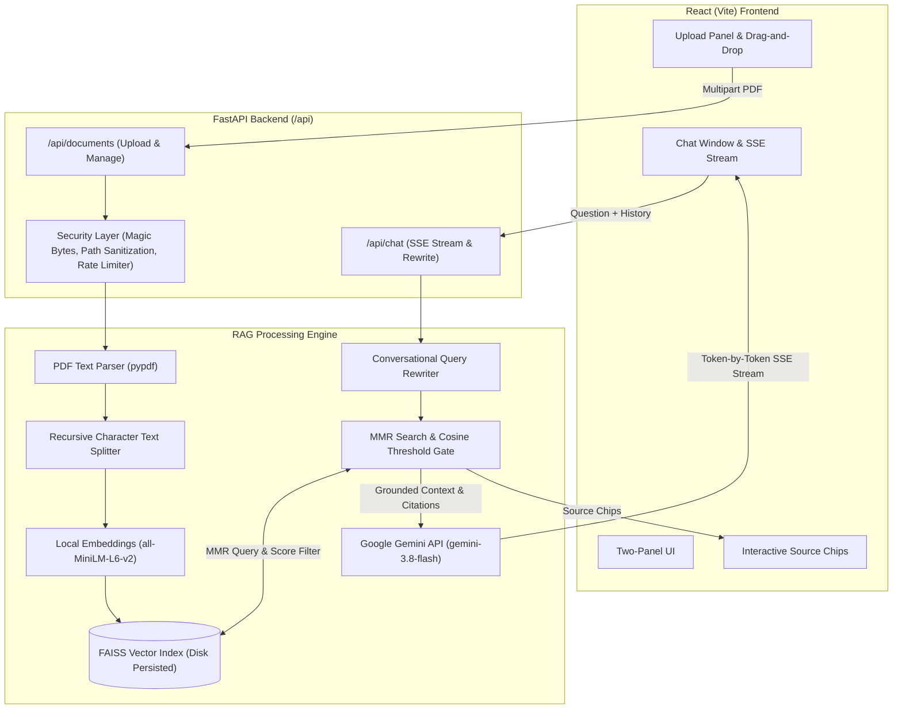

# DocuMind

DocuMind is an open-source Retrieval-Augmented Generation (RAG) web application that lets you upload PDF documents and ask questions grounded strictly in their contents. Instead of relying on a language model's internal memory—which frequently leads to confident hallucinations—DocuMind indexes your documents into searchable semantic chunks, retrieves the most relevant passages using diversity-aware similarity search, and instructs the LLM to answer using only that retrieved context. Every answer includes verifiable citations linking back to the exact source file and page number, and if your documents do not contain the answer, the system explicitly says so rather than guessing.

---

## Architecture



---

## How the RAG Pipeline Works Step by Step

1. **Upload & Security Validation**:
   When a user uploads a PDF, the backend verifies that the file begins with the `%PDF-` magic header (preventing disguised executables) and checks that the size does not exceed the 10 MB limit. Filenames are strictly sanitized to prevent path traversal attacks.

2. **Text Extraction & Cleaning**:
   `pypdf` extracts text page-by-page, retaining the 1-based page number for each page. Control characters, null bytes, and excessive whitespaces are cleaned.

3. **Document Chunking**:
   Text is split using LangChain's `RecursiveCharacterTextSplitter` into chunks of approximately 800 characters with a 150-character overlap. Each chunk retains metadata containing its `document_id`, `filename`, `page`, and `chunk_index`.

4. **Local Embedding & FAISS Persistence**:
   The chunks are converted into dense vector embeddings using the local Hugging Face `all-MiniLM-L6-v2` sentence-transformer model. Vectors are indexed into FAISS with L2 normalization and saved to disk.

5. **Conversational Memory & Query Rewriting**:
   If the user asks a follow-up question (such as *"What about its limitations?"*), DocuMind sends the recent conversation history to Gemini to reformulate the question into a standalone search query (*"What are the limitations of the Transformer architecture?"*) before performing retrieval.

6. **MMR Retrieval & Similarity Gating**:
   DocuMind searches FAISS using Maximal Marginal Relevance (MMR) with $k=5$ to retrieve informative passages while reducing near-duplicate content. It computes cosine similarity for each chunk. If the top similarity score falls below a configurable threshold (default `0.35`), DocuMind stops and immediately responds: *"I couldn't find that in the uploaded documents."*

7. **Prompt Construction with Injection Defense**:
   Retrieved passages are enclosed inside delimited `<context>` and `<passage>` XML-like tags. The system prompt instructs the model to treat the context strictly as untrusted reference data and to cite sources in the format `[filename, p.X]`.

8. **Streaming Generation**:
   The answer streams back token-by-token using Server-Sent Events (SSE). Once complete, the source citations are emitted as an SSE event, rendering interactive, expandable source chips in the UI.

---

## Evaluation Benchmark & Results

DocuMind includes a benchmark suite in the `eval/` folder consisting of a 5-page technical document covering consensus protocols, storage engines, distributed transactions, caching, and networking, evaluated against 16 hand-written question-answer pairs with known target pages.

The benchmark compares retrieval hit rate (`Hit@5`, whether the correct page appears in the top-5 retrieved chunks), first-rank accuracy (`Hit@1`), Mean Reciprocal Rank (`MRR`), and average retrieval latency across different chunk sizes:

| Chunk Size | Overlap | Chunks Generated | Hit@1 (%) | Hit@5 (Hit Rate) | MRR | Avg Latency (ms) | Best |
|:---|:---|:---|:---|:---|:---|:---|:---|
| **500** | 100 | 32 | 100.0% | 100.0% | 1.0000 | 19.28 ms | |
| **800** | 150 | 22 | 100.0% | 100.0% | 1.0000 | 19.51 ms | |
| **1200** | 200 | 15 | 100.0% | 100.0% | 1.0000 | 16.44 ms | **⭐ BEST** |

### Key Takeaways from the Data:
- All three chunk sizes achieved a 100% retrieval hit rate and an MRR of 1.0 on the test dataset.
- Chunk size 1200 proved optimal for retrieval latency (16.44 ms) and vector index compactness (15 chunks versus 32 chunks for size 500).
- For general multi-topic PDFs, the 800-character baseline provides a solid balance between semantic granularity and passage context for the generation model.

To re-run the benchmark locally and verify the numbers:
```bash
python eval/run_eval.py
```

---

## Design Decisions

- **Why `all-MiniLM-L6-v2` for embeddings?**
  It runs completely locally on CPU, requires zero external API keys or network latency, consumes under 150 MB of memory, and produces 384-dimensional normalized vectors that are fast to query.
- **Why Maximal Marginal Relevance (MMR)?**
  Standard top-k similarity search often returns multiple chunks from the exact same paragraph or section that repeat nearly identical wording. MMR balances query relevance with diversity across the retrieved set.
- **Why a similarity threshold cutoff?**
  When a user asks a question completely unrelated to their uploaded files, naive RAG systems will still force-feed the top-5 nearest vectors to the LLM, leading to hallucinations. The cosine similarity cutoff rejects irrelevant queries before calling the generation model.
- **Why Server-Sent Events (SSE)?**
  SSE provides a lightweight, unidirectional text stream over standard HTTP without the connection management and handshake overhead of WebSockets.

---

## Setup & Running Instructions

### Prerequisites
- Python 3.10+
- Node.js 18+
- (Optional) Docker and Docker Compose

### 1. Local Development Setup

#### Backend:
```bash
# Clone the repository
git clone https://github.com/your-username/documind.git
cd documind

# Create and activate virtual environment
python -m venv venv
# On Windows:
.\venv\Scripts\activate
# On Linux/macOS:
source venv/bin/activate

# Install dependencies
pip install -r backend/requirements.txt

# Configure environment variables
cp .env.example .env
# Edit .env and supply your GEMINI_API_KEY

# Start FastAPI server
uvicorn backend.app.main:app --host 127.0.0.1 --port 8000 --reload
```

#### Frontend:
```bash
cd frontend
npm install
npm run dev
```
Open your browser at `http://localhost:5173`.

---

### 2. Docker Setup

To run both backend and frontend in isolated containers:
```bash
# Ensure your GEMINI_API_KEY is configured in .env
docker-compose up --build
```
- Frontend UI: `http://localhost:3000`
- Backend API & Health Check: `http://localhost:8000/api/health`

---

## Running the Tests

DocuMind has 23 automated tests covering file sanitization, PDF validation, chunking, threshold gating, SSE streaming, document CRUD, and end-to-end integration:

```bash
# Run full pytest suite
pytest
```

---

## Limitations

- **Scanned / Image PDFs**: Documents containing scanned images of pages without embedded text layers require an optical character recognition (OCR) engine like Tesseract. Currently, unreadable PDFs are detected and rejected with an explicit error message.
- **Single-User Scope**: All uploaded documents share a local FAISS index on disk. Multi-tenancy with separate vector partitions per user is not enabled in this version.
- **In-Memory Rate Limiting**: The sliding-window rate limiter stores request timestamps in application memory; horizontal multi-instance scaling would require Redis.

---

## Future Improvements

- **Hybrid Search**: Combine BM25 keyword matching with dense vector search (Reciprocal Rank Fusion) for better keyword precision (e.g. acronyms, exact IDs).
- **Cross-Encoder Reranker**: Integrate a small reranker (e.g., `bge-reranker-base`) after initial retrieval to re-score candidate chunks.
- **Authentication & Multi-Tenant Workspaces**: User authentication via JWT with isolated vector storage per organization or user.
